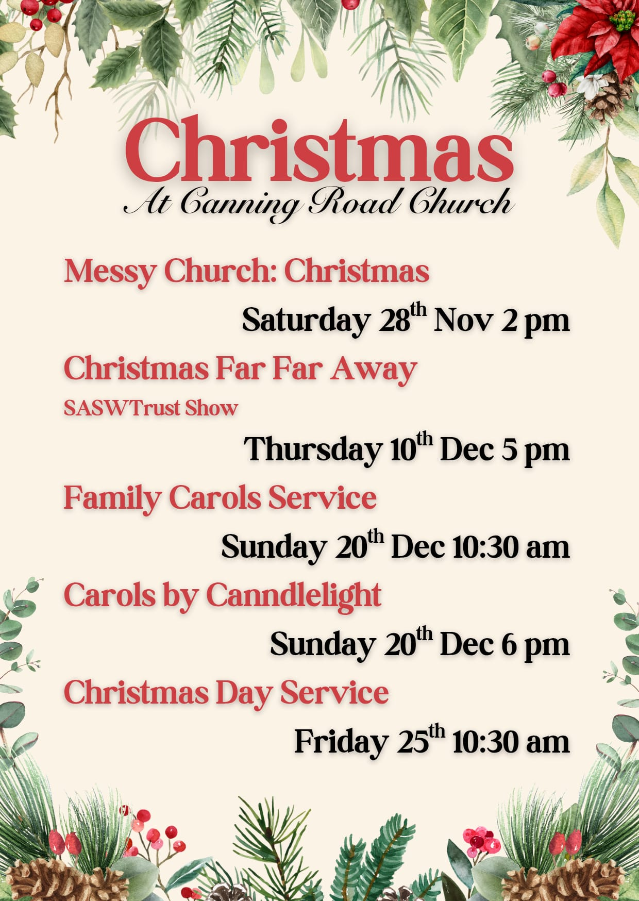

It's beginning to look a lot like Christmas! ❄ Check out what we've got going on this winter season at Canning Road Church:

## Messy Church: Christmas

**Saturday 28th of November - 2pm-4pm**

With festive crafts, songs, a story, and snacks, all families with kids are welcome! 🎄

See our [Messy Church](/services/messychurch/) page.

## Christmas Far Far Away

**Thursday 10th of December - 5pm-6:15pm**

The SASWTrust Schools Worker team will be presenting this year's Christmas show: Christmas Far Far Away. This fun show for all ages takes the place of our usual Hero Academy club on that date. We encourage parents to stay and enjoy the show with their kids!

## Family Carols Service

**Sunday 20th of December - 10:30am**

Our usual Sunday morning service takes a special focus on the beautiful songs of Christmas, and the journey of God's own son to come and live in the neighbourhood.

## Carols by Candlelight

**Sunday 20th of December - 6pm**

🕯 Twelve Christmas Carols with twelve short Bible readings that tell us how Christmas was foretold since ancient times, and came true in the arrival of Jesus. We finish with Mince Pies and drinks.

Will we play your favourite carol? Probably! Come and make it part of your tradition this year. 🎵

## Christmas Day Celebration

**Friday 25th of December - 10:30am**

 + A short, fun, family-friendly service to celebrate Christmas morning, with something for everyone 🎄👨‍👩‍👧‍👦
 + Kids can bring a toy, with time to show it from the front if they want 🎁

☙

We really hope you can join us. See you at church! ⛪🌟
